# TimeSplitters (PS2) static recompilation

A static recompilation of TimeSplitters (PlayStation 2, Free Radical Design,
2000; the USA release, SLUS-200.90) to native code for Windows, Linux and the
original Xbox. The game's MIPS program and VU microcode were translated to C++
with [PS2Recomp](https://github.com/ran-j/PS2Recomp) and run on a runtime that
replaces the PS2 hardware: the Graphics Synthesizer is drawn on the GPU, the
sound chip and IOP are modelled, the memory cards are folders.

No game data is included. You need your own dump of the TimeSplitters (USA)
PS2 disc (a `.bin`/`.cue`, a `.bin` or an `.iso`); the program unpacks it on
the first start.

Downloads: see the [releases](https://github.com/GTTeancum/Timesplitters/releases).

## Screenshots

| | |
|---|---|
| 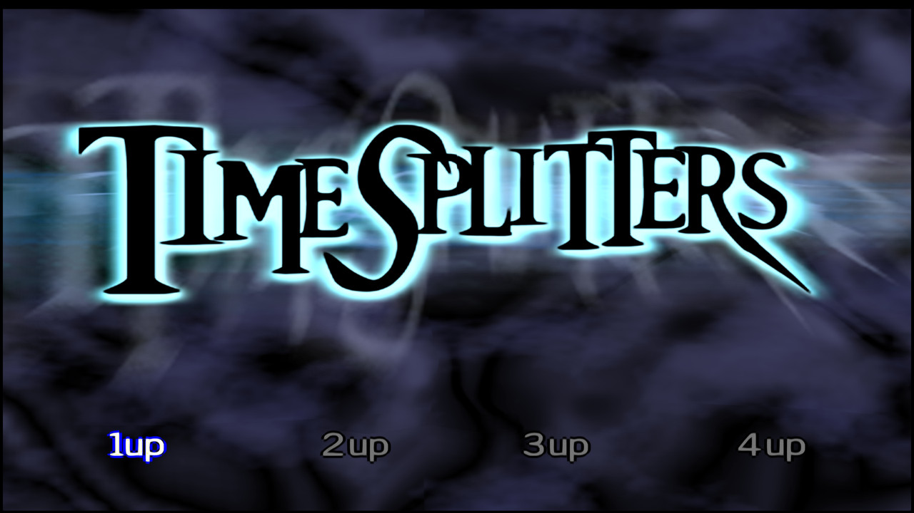 | 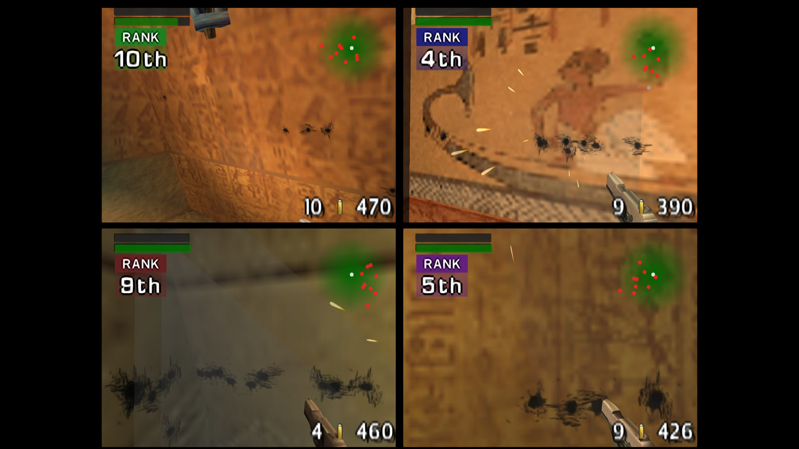 |
| Windows: title screen (1080p, widescreen, 4x render scale, FXAA) | Windows: four-player split screen in Tomb |
| 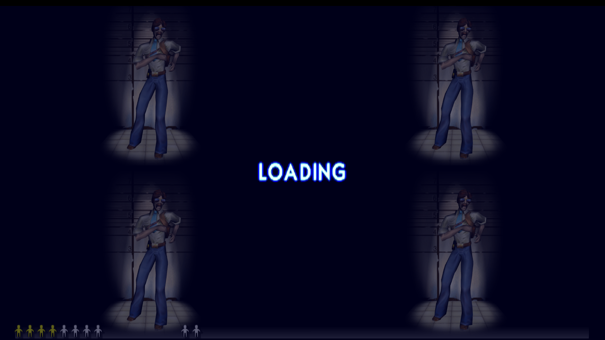 | 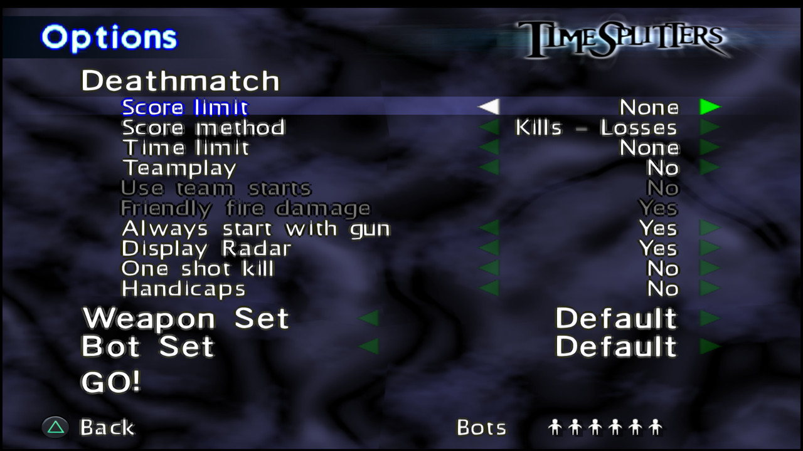 |
| Windows: widescreen loading screen | Windows: Deathmatch options |
| 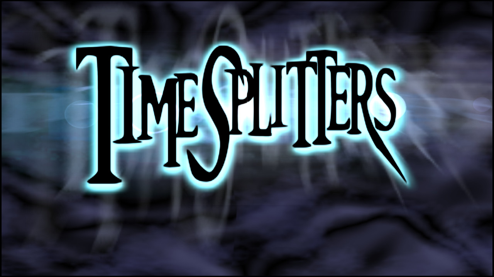 | 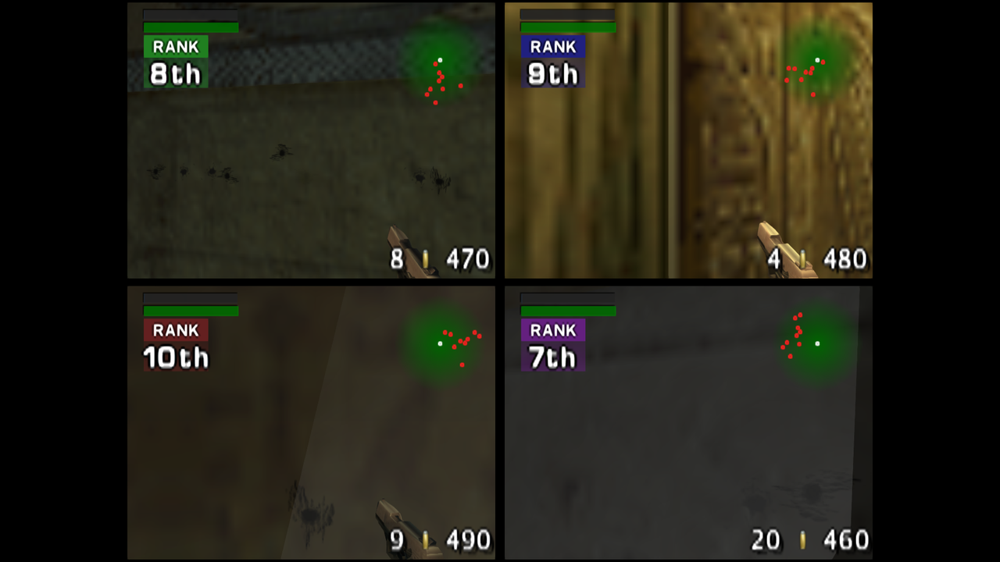 |
| Linux (Ubuntu under WSL2): title screen | Linux: four-player split screen in Tomb |

| | | |
|---|---|---|
| 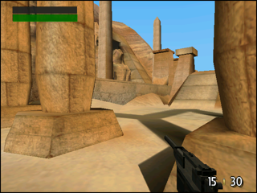 | 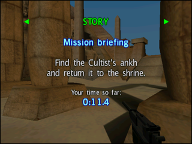 | 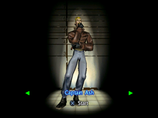 |
| Xbox: story mode, 1935 Tomb | Xbox: mission briefing | Xbox: character select |
| 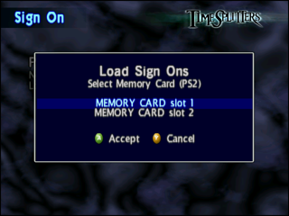 | 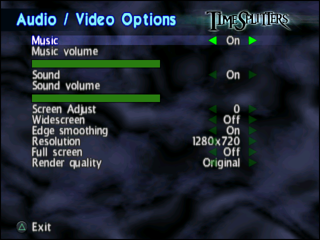 | 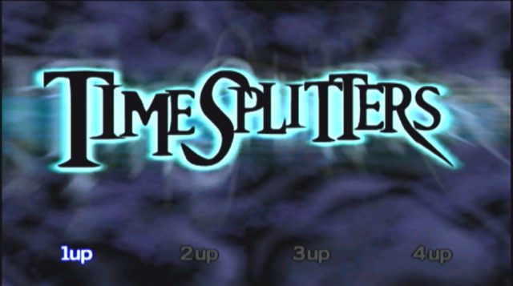 |
| Xbox: Load Sign Ons, with Xbox button prompts | Xbox: Audio / Video Options | Xbox: title screen, captured from the TV |

The Xbox pictures are framebuffer grabs from a real console (640x480, shown
here at half size) and one capture of its TV output.

## Features

- The full game: story, arcade, challenges, the map maker, cheats and
  unlocks, as on the PS2.
- One to four players in split screen, on the PC with up to four controllers.
- PC: any window size or borderless fullscreen, 16:9 widescreen (the game
  shows a wider view; the HUD keeps its proportions), rendering at up to 4x
  the PS2 resolution, FXAA edge smoothing, and texture replacement from PNG
  files. All of it is set from the game's own Audio / Video Options menu or
  from `timesplitters.ini`.
- Xbox: runs from the hard disk of a modded original Xbox, draws with the
  NV2A GPU, shows the Xbox controller's buttons in the game's prompts, and
  keeps saves where the dashboard lists them.
- Saves work on every platform: the two PS2 memory cards are folders on the
  PC and dashboard saves on the Xbox.
- Music and sound play natively (the game's music tracks are decoded by the
  runtime; sound effects go through a model of the SPU2).

## Setup

### Windows

Unzip `TimeSplitters-Recomp-<version>-windows.zip` into a folder you can
write to, put your disc dump next to `timesplitters.exe` and double-click it.
The first start unpacks the disc into a `game-data` folder (about 600 MB, a
minute or two, with a progress window) and the game starts; later starts go
straight to the title screen. Details, the folder layout and modding notes:
[README-PC-SETUP.md](README-PC-SETUP.md).

Requirements: a 64-bit Windows 10 or 11 with an OpenGL 3.3 graphics driver.
The Visual C++ runtime DLLs are included.

### Linux

Unpack `TimeSplitters-Recomp-<version>-linux-x86_64.tar.gz`, put your disc
dump in the folder and run `./timesplitters` from it. The prebuilt program
was built on Ubuntu 26.04 and needs its FFmpeg 8 and OpenGL libraries; on
other distributions build it from source (a few minutes). Under WSL2 start it
with `GALLIUM_DRIVER=d3d12` to use the Windows GPU. Everything else is as on
Windows: [README-LINUX.md](README-LINUX.md).

### Xbox

The Xbox version is a folder on the Xbox hard disk. The release carries only
the program (`default.xbe` with its dashboard icons); the game files are made
from your disc dump on a Windows PC by `Prepare Xbox Files.exe`, which comes
with the Windows release (its `xbox` folder holds the same program):

1. Unzip the Windows release and put your disc dump in the folder.
2. Double-click `Prepare Xbox Files.exe` and choose where to make the
   folder. In well under a minute it makes `TSRecomp` (about 1.1 GB): the
   program, the disc as an `.iso` with Xbox button pictures patched in, the
   game files, and a texture pack prepared for the Xbox GPU.
3. Copy the whole `TSRecomp` folder to the Xbox hard disk (FTP, for example
   as `E:\TSRecomp`) and start `default.xbe` in it from your dashboard.

Saves live in `E:\UDATA\54530001` (shown as "TimeSplitters" in the
dashboard), so replacing `TSRecomp` with a newer version keeps them. Full
steps and the folder contents: [README-XBOX-SETUP.md](README-XBOX-SETUP.md).

## Controls

Controllers come first. On Windows the game reads XInput (Xbox-style)
controllers, up to four, one per player; on Linux it reads `/dev/input`
joysticks. The buttons map to the PS2 pad as you would expect: A, B, X, Y are
Cross, Circle, Square, Triangle; the bumpers are L1 and R1, the triggers L2
and R2; Start and Back are Start and Select; the sticks are the sticks. The
Xbox version uses the console's own controllers and shows their buttons in
the game's prompts.

With no controller in the first slot, player 1 plays on the keyboard:

| PS2 | Keyboard |
|---|---|
| Left stick (move) | W, A, S, D |
| Right stick (look) | I, J, K, L |
| D-pad | Arrow keys |
| Cross | X or Space |
| Circle | C |
| Square | Z or numpad 0 |
| Triangle | V or numpad 1 |
| L1 / R1 | Q / E |
| L2 / R2 | Left Shift / Right Shift |
| Start | Enter |
| Select | Tab |

While playing on the PC: F9 toggles FXAA, F10 widescreen, F11 fullscreen;
Esc, Alt+F4, the menu's Exit Game, or holding Select + Start for two seconds
quits. The default settings (`timesplitters.ini`) are a 1920x1080 window,
widescreen, FXAA and 4x render scale.

## Known issues

- Xbox speed: about 28-30 frames per second in one-player story levels, but
  about 11 in four-player fights. No fog, no GPU points or lines, and textures
  are stored compressed (world textures above 256 pixels at half size).
- Linux: tested on Ubuntu 26.04 under WSL2 (keyboard, saves, four-player
  match). Controllers on Linux are untested. The prebuilt binary needs that
  distribution's libraries; otherwise build from source.
- Sound: reverb, noise and pitch modulation are not modelled; held tones
  may click.
- The movies are decoded with FFmpeg; the Windows package includes the DLLs
  it needs.
- More, with the state of each subsystem, in [KNOWN-ISSUES.md](KNOWN-ISSUES.md).

## Building from source

Windows (the release build): Visual Studio 2022 (MSVC 14.44), CMake and
Ninja. The game's own files must be in `project\game-data` (made by
`scripts\prepare_game.py` from your disc dump). Configure
`source\PS2Recomp` with `-G Ninja -DCMAKE_BUILD_TYPE=Release
-DTS_GAME_SOURCE_DIR=<repo>\project\game -DPS2X_BUILD_RECOMP=OFF
-DPS2X_BUILD_ANALYZER=OFF -DPS2X_BUILD_TEST=OFF -DPS2X_BUILD_STUDIO=OFF
-DPS2X_ENABLE_DEBUG_UI=OFF` and build the `timesplitters` and
`prepare_xbox_files` targets; FFmpeg and raylib are fetched by CMake on the
first configure. The build is `build-release\timesplitters\timesplitters.exe`
with the FFmpeg DLLs next to it (`TS_STAGE_TO_ROOT` also copies them to the
repository root).

Linux: packages, configure line and notes in [README-LINUX.md](README-LINUX.md).

Xbox: the `release-dual` branch, [nxdk](https://github.com/XboxDev/nxdk) at
`C:\nxdk` and MSYS2; `bash src/xbox/build.sh`. See
[src/xbox/README.md](src/xbox/README.md).

## Branches

`master` holds the PC (Windows and Linux) build. `release-dual` holds the
same code with the Xbox build on top; the Xbox-only changes are compiled in
only for the Xbox, so the PC program built from either branch is the same.

## Legal

This is an unofficial fan project and is not affiliated with or endorsed by
Free Radical Design, Eidos Interactive, Deep Silver or Embracer. TimeSplitters
is their property. No game data, code or assets from the disc are included
here or in the releases: the recompiled program contains only the translated
machine code of the game, and every data file is made from the disc you own.

The recompiler and runtime are built on PS2Recomp, which is under the GNU
General Public License version 3 (`source/PS2Recomp/LICENSE`); this
repository's own code is distributed under the same terms. The Xbox build
uses nxdk (the Xbox Development Kit by XboxDev), whose components are under
the MIT, Apache 2.0, NCSA, CC0 and NVIDIA Cg licences, and PC builds use
raylib (zlib licence) and FFmpeg (LGPL 2.1 or later, as the shared libraries
in the packages). There is no separate licence file at the top of this
repository.
